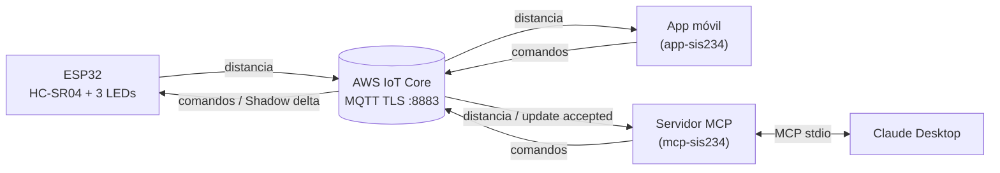

# SIS-234 — Objeto inteligente con AWS IoT Core, Device Shadow y MCP

ESP32 + sensor ultrasónico HC-SR04 + 3 LEDs, conectado a **AWS IoT Core** por MQTT/TLS con certificado de cliente, controlable desde una app móvil y desde **Claude Desktop** mediante un servidor **MCP**.



## Integrantes

| Integrante | GitHub |
|---|---|
| Luis Felipe Velasco Lopez | [@feliLuis](https://github.com/feliLuis) |
| Jesús Ariel Mamani Gutierrez | [@JesusxAriel](https://github.com/JesusxAriel) |
| Leonardo Koller Mejia | [@leoGKM](https://github.com/leoGKM) |

## Estructura del proyecto

```text
firmware/     ESP32 (PlatformIO, C++ orientado a objetos)
mcp-server/   Servidor MCP (Python) + pruebas
config/       Claude Desktop + políticas AWS de referencia
docs/         Guías: AWS, circuito, tópicos, Shadow, app móvil, pruebas e implementación
```

## Tópicos MQTT y formato de los mensajes

Región AWS: `us-east-2`. Thing: `esp32-sis234`. Todos los mensajes son JSON y se publican con QoS 0.

### Tópicos propios

| Tópico | Publica | Se suscribe | Mensaje |
|---|---|---|---|
| `sis234/esp32/distancia` | ESP32 (cada 400 ms) | App, servidor MCP | `{"cm":42.7}` |
| `sis234/esp32/comandos` | App, servidor MCP | ESP32 | `{"led":"rojo","estado":"on"}` |

**Valores válidos en los comandos** (no distinguen mayúsculas):

- `led`: `rojo`, `amarillo`, `verde`
- `estado`: `on`, `off`
- `cm`: número decimal, distancia en centímetros.

Un comando con JSON inválido, campos faltantes o valores desconocidos se descarta sin modificar ningún LED. Cada comando controla **un solo LED**.

### Device Shadow clásico

Prefijo: `$aws/things/esp32-sis234/shadow`

| Tópico | Publica | Se suscribe | Uso |
|---|---|---|---|
| `.../get` | ESP32 (payload vacío) | AWS | Pide el Shadow al (re)conectar para recuperar `desired`. |
| `.../get/accepted` | AWS | ESP32 | Respuesta con el Shadow; el ESP32 aplica `desired`. |
| `.../update` | ESP32 | AWS | Reporta el estado real de los LEDs. |
| `.../update/delta` | AWS | ESP32 | Diferencia `desired` ≠ `reported`; el ESP32 la aplica y reporta. |
| `.../update/accepted` | AWS | ESP32, servidor MCP | Confirmación de AWS; el ESP32 solo la registra. |
| `.../update/rejected`, `.../get/rejected` | AWS | ESP32 (opcional) | Solo si `SHADOW_SUBSCRIBE_REJECTED=1` y la política lo autoriza. |

**Documento Shadow:**

```json
{
  "state": {
    "desired":  { "leds": { "rojo": "on", "amarillo": "off", "verde": "off" } },
    "reported": { "leds": { "rojo": "on", "amarillo": "off", "verde": "off" } }
  }
}
```

**Reglas de sincronización:**

- **delta:** se aplica al LED y se reporta; nunca se modifica `desired`.
- **get/accepted** (tras reconectar): se aplica `desired` y se reporta el estado real. Si AWS no responde en 5 s, se reporta el estado actual.
- **Comando directo** (tópico `comandos`): se aplica y se publica `desired = reported`, para que no aparezca un delta que revierta el cambio.

Más detalle en [`docs/MQTT_TOPICOS.md`](docs/MQTT_TOPICOS.md) y [`docs/DEVICE_SHADOW.md`](docs/DEVICE_SHADOW.md).

## Herramientas MCP expuestas

Servidor `smart-object` (transporte stdio).

| Herramienta | Parámetros | Propósito |
|---|---|---|
| `get_distance` | — | Última distancia válida (cm) y su antigüedad; avisa si la lectura es antigua. |
| `get_system_status` | — | Conexión con AWS IoT, antigüedad de la última lectura y LEDs reportados por el ESP32. |
| `set_led` | `color` (`rojo`, `verde`, `amarillo`), `state` (`on`, `off`) | Enciende o apaga **un** LED sin tocar los demás; espera confirmación del ESP32. |
| `only_led` | `color` (`rojo`, `verde`, `amarillo`) | Enciende solo ese LED y apaga los demás. |
| `all_leds_on` | — | Enciende los 3 LEDs. |
| `all_leds_off` | — | Apaga los 3 LEDs. |
| `get_shadow_state` | — | Consulta en AWS `reported`, `desired` y `delta` del Shadow. Solo se registra si el Shadow está habilitado; requiere permisos de Shadow en la política del servidor. |

Las herramientas de LED responden **CONFIRMADO** solo si el ESP32 reportó el cambio después del envío; si no, responden **enviado, SIN confirmar**. Detalle en [`mcp-server/README.md`](mcp-server/README.md).

## Requerimientos no funcionales

| Atributo | Valor |
|---|---|
| Rango de trabajo | Rango físico del sensor configurado: 2 cm a 400 cm. ⚠️ MEDIR rango de trabajo real: __ cm a __ cm |
| Estabilidad | ⚠️ MEDIR: __ min sin reinicios |
| Exactitud | ⚠️ MEDIR: error máximo ± __ cm (mediana de 3 lecturas por medición) |
| Tiempo de respuesta | ⚠️ MEDIR: __ s (comando → LED encendido) |
| Frecuencia de publicación | 2,5 lecturas/s configuradas (cada 400 ms); ⚠️ medido: __ lecturas/s |
| Reconexión | Automática: WiFi cada 5 s y MQTT cada 5 s; tras reconectar se re-suscribe y se recupera el Shadow. |

## Cómo ejecutar el sistema

**Requisitos:** cuenta AWS (región `us-east-2`), PlatformIO, Python ≥ 3.10, `uv`, Claude Desktop, y un ESP32 con HC-SR04 y 3 LEDs.

### Conexiones del ESP32

| Componente | GPIO |
|---|---|
| HC-SR04 TRIG | 27 |
| HC-SR04 ECHO | 26 (con divisor de voltaje 1k/2k: el ECHO entrega 5 V) |
| LED rojo | 14 |
| LED verde | 13 |
| LED amarillo | 12 (pin de arranque, ver `docs/CIRCUITO.md`) |

### 1. AWS IoT Core
1. Crear el Thing `esp32-sis234`.
2. Crear un certificado por cliente (ESP32, servidor MCP, app móvil) y adjuntar a cada uno su política de `config/` (mínimos privilegios; la del ESP32 es `PoliticaESP32SIS234`).
3. Copiar el endpoint de AWS IoT (Settings → Device data endpoint).

Guía detallada: [`docs/AWS_CONFIGURACION.md`](docs/AWS_CONFIGURACION.md).

### 2. Firmware (ESP32)
1. Copiar `firmware/include/config.example.h` a `config.h` y completar `WIFI_SSID`, `WIFI_PASSWORD` y, si cambia, el endpoint.
2. Copiar `aws_certificates.example.h` a `aws_certificates.h` y pegar CA, certificado y clave **de la ESP32**.
3. Armar el circuito (ver `docs/CIRCUITO.md`).
4. Compilar y cargar:
   ```bash
   cd firmware
   pio run -t upload
   pio device monitor
   ```

### 3. Servidor MCP
```bash
cd mcp-server
uv sync
cp .env.example .env     # completar endpoint y rutas
# copiar a certs/: AmazonRootCA1.pem, mcp-certificate.pem.crt, mcp-private.pem.key
uv run python -m unittest discover -s tests   # pruebas (25, sin red ni hardware)
uv run smart-object.py                        # prueba manual (Ctrl+C para salir)
```

### 4. Claude Desktop
1. Tomar `config/claude_desktop_config.example.json`, poner la ruta absoluta de `mcp-server` y agregarlo a la configuración de Claude Desktop.
2. Reiniciar Claude Desktop y verificar que aparezcan las herramientas.
3. Probar con frases como "¿a qué distancia está el objeto?" o "enciende solo el LED rojo".
4. Logs (Windows): `%APPDATA%\Claude\logs\mcp-server-smart-object.log`.

### 5. App móvil
⚠️ Ver la guía de la app en `docs/` (indicar aquí el nombre exacto del archivo).

### Archivos privados que debes crear (no se suben a Git)

| Archivo | Contenido |
|---|---|
| `firmware/include/config.h` | WiFi, pines y endpoint. |
| `firmware/include/aws_certificates.h` | CA + certificado + clave de la ESP32. |
| `mcp-server/.env` | Endpoint y rutas. |
| `mcp-server/certs/` | CA + certificado + clave del servidor MCP. |
| `claude_desktop_config.json` | Ruta absoluta del servidor MCP (copia local de `claude_desktop_config.example.json`). |

## Estado de validación

- ✅ **Servidor MCP:** 25 pruebas automáticas con cliente MQTT simulado.
- ⬜ **Firmware:** ⚠️ actualizar cuando se pruebe en hardware.
- ⬜ **Integración:** ⚠️ actualizar cuando se pruebe AWS real, app móvil y Claude Desktop (ver `docs/PRUEBAS.md`).

## Seguridad

Ninguna clave, certificado ni contraseña está incluida en este repositorio.

El `.gitignore` excluye `*.pem`, `*.key`, `*.crt`, `*.p12`, `config.h`, `aws_certificates.h` y `.env`.

Cada cliente (ESP32, servidor MCP y app móvil) utiliza su **propio certificado** y una política AWS de mínimos privilegios.