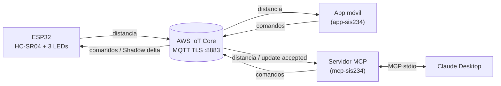

# SIS-234 — Objeto inteligente con AWS IoT Core, Device Shadow y MCP

ESP32 + sensor ultrasónico HC-SR04 + 3 LEDs, conectado a **AWS IoT Core** por MQTT/TLS con certificado de cliente, controlable desde una app móvil y desde **Claude Desktop** mediante un servidor **MCP**.



## Integrantes
- _Nombre 1_ — GitHub: `...`
- _Nombre 2_ — GitHub: `...`

## Estructura
```
firmware/     ESP32 (PlatformIO, C++ orientado a objetos)
mcp-server/   Servidor MCP (Python) + pruebas
config/       Claude Desktop + políticas AWS de referencia
docs/         Guías: AWS, circuito, tópicos, Shadow, app móvil, pruebas, implementación
```

## Qué leer primero
1. `docs/GUIA_IMPLEMENTACION.md` — orden de trabajo paso a paso
2. `docs/AWS_CONFIGURACION.md` — qué verificar y crear en AWS (no se crea nada automáticamente)

## Archivos que debes configurar con tus datos (no se suben a Git)
| Archivo | Contenido |
|---|---|
| `firmware/include/config.h` | WiFi, pines (copiar de `config.example.h`) |
| `firmware/include/aws_certificates.h` | CA + certificado + clave **de la ESP32** (copiar de `aws_certificates.example.h`) |
| `mcp-server/.env` | Endpoint y rutas (copiar de `.env.example`) |
| `mcp-server/certs/*` | CA + certificado + clave **del servidor MCP** (identidad distinta de la ESP32) |
| `claude_desktop_config.json` | Ruta absoluta del servidor |

## Tópicos
| Tópico | Publica | Mensaje |
|---|---|---|
| `sis234/esp32/distancia` | ESP32 | `{"cm":42.7}` |
| `sis234/esp32/comandos` | App, servidor MCP | `{"led":"rojo","estado":"on"}` |
| `$aws/things/esp32-sis234/shadow/...` | ESP32, AWS | Device Shadow clásico |

Detalle en `docs/MQTT_TOPICOS.md` y `docs/DEVICE_SHADOW.md`.

## Requerimientos no funcionales (completar tras medir)
| Atributo | Valor medido |
|---|---|
| Rango de trabajo | _… cm a … cm_ |
| Estabilidad | _… min sin reinicios_ |
| Exactitud | _error máx. ± … cm_ |
| Tiempo de respuesta | _… s_ |
| Frecuencia de publicación | 2,5 lecturas/s configuradas; _medido: …_ |
| Reconexión | automática (WiFi y MQTT) |

## Estado de validación
- ✅ Servidor MCP: 25 pruebas automáticas con cliente MQTT simulado.
- ⬜ Firmware: **no compilado** ni probado en hardware.
- ⬜ Integración con AWS real, app móvil y Claude Desktop: pendiente (ver `docs/PRUEBAS.md`).

## Seguridad
Ninguna clave, certificado ni contraseña está en este repositorio. El `.gitignore` excluye `*.pem`, `*.key`, `*.crt`, `*.p12`, `config.h`, `aws_certificates.h` y `.env`. Cada cliente (ESP32, servidor MCP, app) usa su **propio** certificado con una política de mínimos privilegios.
