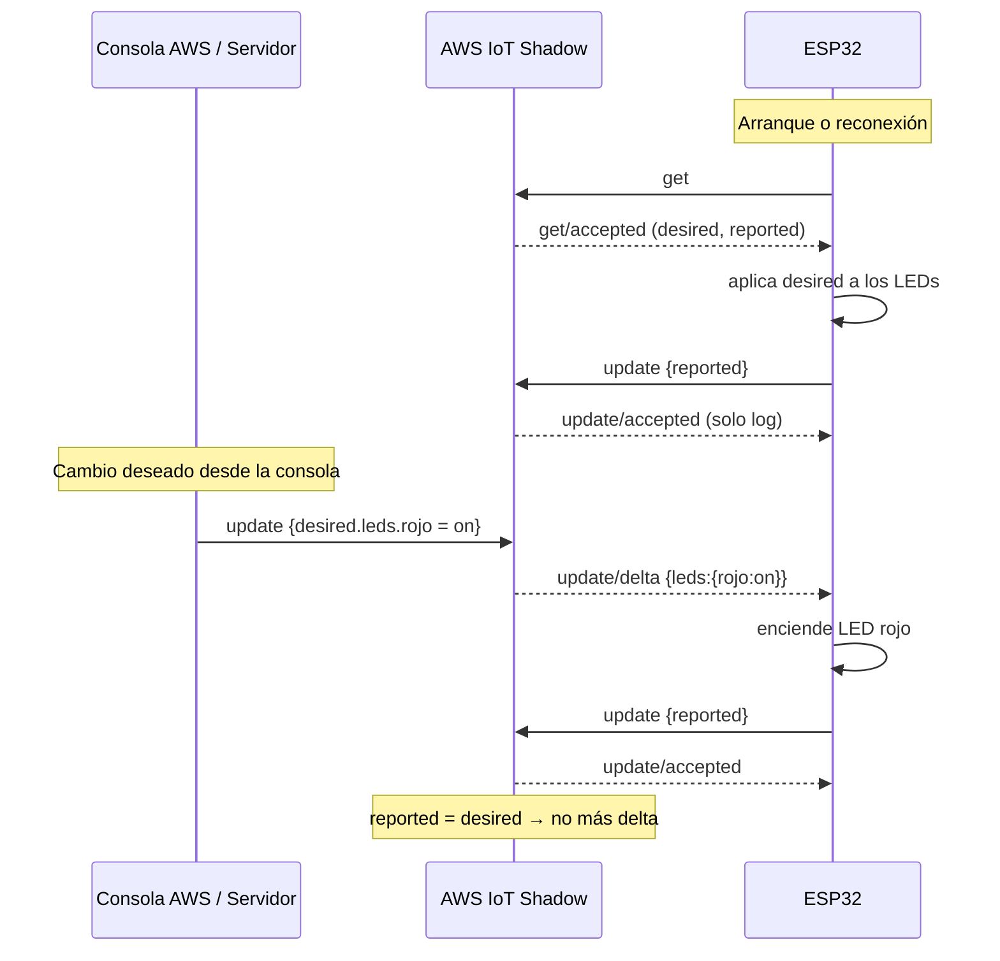

# Device Shadow clásico

## Documento

```json
{
  "state": {
    "desired":  { "leds": { "rojo": "on", "verde": "off", "amarillo": "off" } },
    "reported": { "leds": { "rojo": "on", "verde": "off", "amarillo": "off" } }
  }
}
```

- `reported`: lo que la ESP32 dice que tiene. **Solo lo escribe la ESP32.**
- `desired`: lo que se quiere. Lo escribe la consola de AWS o la propia ESP32 tras un comando directo.
- `delta`: lo calcula AWS (`desired` ≠ `reported`) y lo publica en `update/delta`.

## Reglas del firmware (`ShadowManager`)

| Evento | Acción |
|---|---|
| Conexión MQTT establecida | Publica `shadow/get` |
| `get/accepted` | Aplica `desired.leds` y reporta el estado real |
| `get` sin respuesta en 5 s | Reporta igualmente (crea el Shadow si no existe) |
| `update/delta` | Aplica los LEDs del delta y reporta (esto elimina el delta) |
| Comando directo válido | Aplica el LED y publica `reported` **y** `desired` iguales |
| `update/accepted` | Solo registra en el monitor serie |

### Por qué un comando directo también actualiza `desired`
Si solo cambiara `reported`, el Shadow seguiría diciendo `desired: off`; AWS calcularía un delta y la ESP32 apagaría el LED que acaba de encender. Al igualar `desired` y `reported` no hay delta.

### Cómo se evitan ciclos
- La ESP32 **nunca** reacciona a `update/accepted` ni escribe `desired` a raíz de un delta.
- Reportar después de aplicar un delta hace `reported = desired`, y AWS deja de enviar delta.
- Las publicaciones se hacen en `update()`, fuera del callback MQTT (PubSubClient reutiliza un único buffer para recibir y publicar).
- Varios cambios seguidos se agrupan en una sola publicación.



## Confirmación en el servidor MCP
El servidor se suscribe a `update/accepted`. Ese mensaje contiene el `reported` que la ESP32 acaba de enviar, por lo que **solo llega después de que el dispositivo aplicó el cambio**. `set_led`/`only_led` publican el comando y esperan hasta `CONFIRM_TIMEOUT_S` (3 s) un reporte posterior al envío con el estado pedido:

| Resultado | Significado |
|---|---|
| `CONFIRMADO por el ESP32` | El dispositivo reportó el nuevo estado tras el envío |
| `enviado, SIN confirmar` | AWS aceptó el mensaje, pero el ESP32 no reportó a tiempo |
| `NO ENVIADO` | No hubo conexión o la publicación falló |

Limitación: el dispositivo reporta lo que *ordenó* a los GPIO; no hay un sensor que mida si el LED físicamente luce. Si un LED está mal cableado, el sistema lo dará por confirmado.

## Probar el Shadow sin código
Consola → Thing `esp32-sis234` → Device Shadows → Classic Shadow → editar:
```json
{ "state": { "desired": { "leds": { "amarillo": "on" } } } }
```
El LED amarillo debe encenderse y `reported` debe actualizarse.
